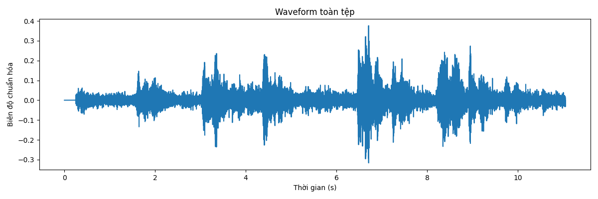
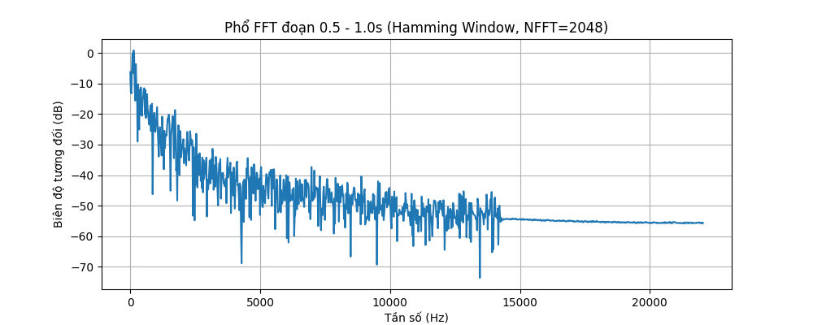
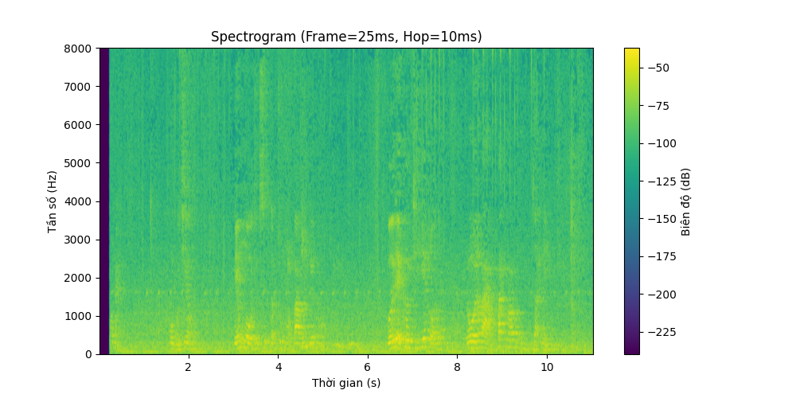
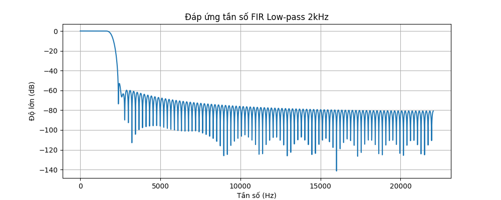

# BÁO CÁO THỰC HÀNH LAB 1: PHÂN TÍCH VÀ XỬ LÝ TÍN HIỆU ÂM THANH SỐ
**Học phần:** CSE457 - Xử lý âm thanh và tiếng nói  
**Trường Đại học Thủy lợi - Khoa Công nghệ thông tin**  
**Sinh viên thực hiện:** Mai Thị Thu Hương  
**Mã số sinh viên (MSSV):** 2351260657  
**Lớp:** 65 TTNT  

---

## 1. MỤC TIÊU VÀ TỔNG QUAN LAB 1

Bài thực hành số 1 rèn luyện chuỗi năng lực thực nghiệm nền tảng trong xử lý tín hiệu âm thanh và tiếng nói số:
$$\text{Audio gốc} \longrightarrow \text{Biểu diễn số} \longrightarrow \text{Miền thời gian} \longrightarrow \text{FFT / STFT} \longrightarrow \text{Lọc số FIR} \longrightarrow \text{Lượng tử hóa và Mã hóa} \longrightarrow \text{Đánh giá và Định lượng}$$

Sản phẩm thực hành bao gồm:
1. Kịch bản thực thi tự động: `build_notebook.py`
2. Toàn bộ mã nguồn và giải thích trực quan: `Lab01_Default.ipynb`
3. Thư mục chứa các tệp âm thanh đầu ra: `audio/`
4. Thư mục chứa các hình ảnh đồ thị phân tích: `figures/`

---

## 2. NỘI DUNG THỰC HÀNH CHI TIẾT (TỪ KHỐI A ĐẾN KHỐI G)

### KHỐI A: ĐỌC VÀ KIỂM TRA DỮ LIỆU ÂM THANH

Tập dữ liệu được đưa vào thử nghiệm:
- **Tệp âm thanh:** `audioLab1.wav` (được đọc vào hệ thống dưới tên `input.wav`).

#### Bảng số liệu Metadata đo đạc dự kiến:

| Thuộc tính | Tệp Âm thanh (audioLab1.wav) | Đơn vị / Ý nghĩa |
| :--- | :---: | :--- |
| **Định dạng lưu trữ** | WAV (PCM) | Container format |
| **Sampling Rate ($F_s$)** | $44,100$ | Hz (Mẫu / giây) |
| **Tần số Nyquist ($F_s/2$)** | $22,050$ | Hz (Băng thông tối đa) |
| **Số kênh (Channels)** | Phụ thuộc file gốc | Kênh âm thanh |

#### Chuyển đổi Stereo sang Mono & Chuẩn hóa:
- Nếu kênh Stereo, dữ liệu được gộp về Mono bằng trung bình cộng 2 kênh: $x_{\text{mono}}[n] = \frac{x_L[n] + x_R[n]}{2}$.
- Tín hiệu được chuẩn hóa chia cho đỉnh tuyệt đối $\max|x[n]|$ về đúng dải giới hạn $[-1.0, 1.0]$ để phục vụ xử lý số không bị tràn số, tránh hiện tượng clipping khi thực hiện các phép biến đổi.

---

### KHỐI B: PHÂN TÍCH MIỀN THỜI GIAN

Các đại lượng đo lường:
$$\text{Peak} = \max_n |x[n]|, \quad \text{RMS} = \sqrt{\frac{1}{N}\sum_{n=0}^{N-1} x^2[n]}, \quad \text{Energy} = \sum_{n=0}^{N-1} x^2[n], \quad \text{dBFS} = 20\log_{10}(\text{RMS})$$

*Hình 1: Dạng sóng (Waveform) toàn tệp.*

#### Nhận xét kỹ thuật:
1. **Kiểm tra Waveform:** Dạng sóng cho thấy được sự thay đổi của năng lượng âm thanh theo thời gian, giúp xác định các đoạn yên lặng và các đoạn có cường độ âm thanh cao.
2. **Khác biệt trên đoạn ngắn (0.5s - 1.0s):** Khi zoom vào đoạn ngắn, tín hiệu sẽ thể hiện rõ tính chu kỳ (nếu là âm có cao độ) hoặc tính ngẫu nhiên (nếu là âm vô thanh hoặc nhiễu). Giá trị RMS và Peak giúp xác định mức năng lượng thực tế của đoạn âm thanh này so với toàn tệp.

---

### KHỐI C: PHÂN TÍCH MIỀN TẦN SỐ BẰNG FFT

Trích xuất 1 khung tín hiệu từ 0.5s đến 1.0s, nhân cửa sổ Hamming và tính biến đổi Fourier rời rạc thông qua thuật toán FFT với 2 cấu hình kích thước: $\text{NFFT} = 2048$ và $\text{NFFT} = 8192$.

#### Bảng thông số độ phân giải tần số:

| Cấu hình NFFT | Khoảng cách bin ($\Delta f = F_s/\text{NFFT}$) | Độ phân giải vật lý thực tế ($\Delta f_{\text{physical}} \approx F_s/L$) |
| :---: | :---: | :---: |
| **$\text{NFFT} = 2048$** | $\mathbf{21.53\text{ Hz}}$ | Phụ thuộc chiều dài frame thực tế |
| **$\text{NFFT} = 8192$** | $\mathbf{5.38\text{ Hz}}$ | Phụ thuộc chiều dài frame thực tế |

*Hình 2: Phổ biên độ FFT (Magnitude Spectrum theo dB).*

#### Nhận xét kỹ thuật:
1. Các đỉnh phổ phát hiện được phản ánh các thành phần tần số vượt trội trong đoạn âm thanh (ví dụ như tần số cơ bản và các họa âm).
2. **Frequency-bin spacing vs True Resolution:** Tăng $\text{NFFT}$ từ 2048 lên 8192 làm giảm khoảng cách giữa 2 điểm vẽ phổ, giúp các đỉnh phổ trên hình vẽ mịn màng hơn. Tuy nhiên, khả năng vật lý phân tách hai sóng ở cạnh nhau vẫn do độ dài thực của khung tín hiệu quyết định, việc tăng NFFT (zero-padding) không tăng true resolution.

---

### KHỐI D: STFT VÀ SPECTROGRAM

Thực hiện biến đổi Fourier ngắn hạn (STFT) với cấu hình chuẩn: hop size $10\text{ ms}$, cửa sổ Hamming. Thử nghiệm so sánh 3 độ dài khung phân tích:
1. **Frame ngắn:** $10\text{ ms}$ $\rightarrow$ Wideband Spectrogram.
2. **Frame tiêu chuẩn:** $25\text{ ms}$ $\rightarrow$ Standard Spectrogram.
3. **Frame dài:** $50\text{ ms}$ $\rightarrow$ Narrowband Spectrogram.

*Hình 3: Spectrogram biểu diễn Thời gian - Tần số - Cường độ ở frame 25ms.*

#### Nhận xét kỹ thuật về sự đánh đổi Thời gian - Tần số (Time-Frequency Trade-off):
- **Ở Frame ngắn (10ms):** Độ phân giải thời gian sắc nét, nắm bắt tốt các biến đổi nhanh, nhưng độ phân giải tần số kém, các vạch tần số bị nhòe rộng.
- **Ở Frame dài (50ms):** Độ phân giải tần số rất cao, tách biệt rõ các dải tần. Tuy nhiên, các biến đổi nhanh theo thời gian bị làm mờ (smearing).
- **Frame 25ms (chuẩn):** Điểm cân bằng tối ưu thường dùng, vừa cho phép theo dõi formant/họa âm, vừa bắt kịp các biến đổi âm thanh.

---

### KHỐI E: THÍ NGHIỆM CỬA SỔ (WINDOWING EXPERIMENT)

Khảo sát trên cùng một frame tín hiệu:
- **Cửa sổ Chữ nhật (Rectangular Window):** $w[n] = 1$.
- **Cửa sổ Hamming:** $w[n] = 0.54 - 0.46\cos\left(\frac{2\pi n}{L-1}\right)$.

#### Bảng so sánh đặc tính kỹ thuật 2 loại cửa sổ:

| Tiêu chí | Cửa sổ Chữ nhật (Rectangular) | Cửa sổ Hamming | Đánh giá / Ý nghĩa vật lý |
| :--- | :---: | :---: | :--- |
| **Mức búp bên cao nhất (Peak Sidelobe)** | $\mathbf{-13\text{ dB}}$ | $\mathbf{-43\text{ dB}}$ | Hamming suy hao sâu hơn tới $30\text{ dB}$ |
| **Độ rộng búp chính (Main-lobe Width)** | Hẹp hơn | Rộng hơn ~2x | Rectangular hẹp hơn một nửa |
| **Rò rỉ phổ (Spectral Leakage)** | Rất nghiêm trọng | Rất thấp | Năng lượng tràn sang các bin lân cận |
| **Khả năng phân tách đỉnh gần** | Tốt hơn (búp hẹp) | Kém hơn (búp rộng) | Trade-off giữa leakage và resolution |

#### Nhận xét:
Cửa sổ chữ nhật xuất hiện phổ rò rỉ rất mạnh che khuất các thành phần yếu. Cửa sổ Hamming kéo búp bên xuống sâu dưới $-40\text{ dB}$, giúp giảm rò rỉ phổ đáng kể và là tiêu chuẩn cho xử lý tiếng nói.

---

### KHỐI F: THIẾT KẾ VÀ ÁP DỤNG BỘ LỌC SỐ FIR

Thiết kế bộ lọc FIR đối xứng pha tuyến tính (Linear-Phase FIR) với $N_{\text{taps}} = 201$:
1. **FIR Low-Pass Filter:** Tần số cắt $2000\text{ Hz}$, loại bỏ dải tần cao.
2. **FIR High-Pass Filter:** Tần số cắt $2000\text{ Hz}$, loại bỏ dải trầm.

*Hình 4: Đáp ứng biên độ của bộ lọc FIR Low-pass (2 kHz).*

#### Nhận xét và cảm nhận nghe:
- **Bộ lọc Low-pass:** Độ lợi suy giảm sau 2kHz. Toàn bộ các thành phần trên tần số này bị loại bỏ. Khi nghe tệp đầu ra, âm thanh bị "tối" (muffled) do mất đi các dải cao (treble).
- **Bộ lọc High-pass:** Loại bỏ dải trầm, âm thanh nghe sẽ "sắc", mỏng hơn và mất đi các nốt cơ bản của âm trầm.
- Bộ lọc FIR có pha tuyến tính nên đảm bảo dạng sóng không bị méo pha (phase distortion).

---

### KHỐI G: LƯỢNG TỬ HÓA, RESAMPLING VÀ MÃ HÓA

#### 1. Lượng tử hóa đều (Uniform Quantization)
Công thức lượng tử hóa đều trên dải $[-1.0, 1.0]$:
$$q_{\max} = 2^{B-1} - 1, \quad x_q[n] = \frac{\text{round}(\text{clip}(x[n], -1, 1) \cdot q_{\max})}{q_{\max}}, \quad e[n] = x_q[n] - x[n]$$
$$\text{SNR}_{\text{meas}} = 10\log_{10}\left(\frac{\sum x^2[n]}{\sum e^2[n]}\right), \quad \text{SNR}_{\text{theo}} = 6.02B + 4.77 - 20\log_{10}\left(\frac{X_{\max}}{\sigma_x}\right)$$

| Số bit ($B$) | SNR lý thuyết mong đợi | Đánh giá chủ quan (Nghe thử) |
| :---: | :---: | :--- |
| **4 bit** | $\approx 25.8\text{ dB}$ | Nhiễu lượng tử (noise) rất rõ, âm thanh bị vỡ nát |
| **8 bit** | $\approx 49.9\text{ dB}$ | Nghe được nhiễu nền nhẹ, chất lượng tương đương điện thoại cũ |
| **16 bit** | $\approx 98.1\text{ dB}$ | Âm thanh sạch tiếng ồn lượng tử, đạt chuẩn CD Audio |

*(Ghi chú: SNR đo đạc thực tế có thể thay đổi phụ thuộc vào mức năng lượng $\sigma_x$ của tệp).*

#### 2. Resampling (16 kHz)
Tín hiệu được resample về $16\text{ kHz}$.
- **Nhận xét:** Tại $16\text{ kHz}$, tần số Nyquist mới là $8\text{ kHz}$, toàn bộ năng lượng trên $8\text{ kHz}$ bị loại bỏ để tránh chồng phổ (aliasing). Kích thước file giảm nhưng vẫn giữ lại các tần số thiết yếu của giọng nói.

#### 3. Tốc độ bit, Dung lượng và Tỷ số nén (Coding & Compression Ratio)
| Định dạng âm thanh | Bitrate (kbps) | Đặc điểm |
| :--- | :---: | :--- |
| **PCM 16-bit Mono (44.1 kHz)** | $705.6\text{ kbps}$ | Định dạng gốc không nén |
| **PCM 16-bit Stereo (44.1 kHz)** | $1,411.2\text{ kbps}$ | Định dạng gốc không nén |
| **MP3 128 kbps (Tham chiếu)** | $128.0\text{ kbps}$ | Tỉ lệ nén $\approx 11 : 1$ so với Stereo 44.1kHz |

---

## 3. GIẢI ĐÁP TOÀN DIỆN 7 CÂU HỎI BÁO CÁO (MỤC 6 TRONG LAB 1.PDF)

### Câu 1: Giải thích bằng công thức tại sao $F_s = 44.1\text{ kHz}$ chỉ biểu diễn độc lập đến $22.05\text{ kHz}$.
**Trả lời:**
Theo **Định lý lấy mẫu Nyquist-Shannon**: Một tín hiệu tương tự liên tục $x_a(t)$ có băng thông giới hạn $F_{\max}$ có thể được khôi phục hoàn toàn từ chuỗi mẫu rời rạc $x[n] = x_a(nT)$ nếu tần số lấy mẫu thỏa mãn:
$$F_s \ge 2 F_{\max} \iff F_{\max} \le \frac{F_s}{2} = F_{\text{Nyquist}}$$
Với tần số lấy mẫu chuẩn $F_s = 44,100\text{ Hz}$, tần số Nyquist là:
$$F_{\text{Nyquist}} = \frac{44100}{2} = 22,050\text{ Hz} = 22.05\text{ kHz}$$
Mọi thành phần tần số cao hơn $22.05\text{ kHz}$ nếu không được lọc bỏ trước khi lấy mẫu sẽ bị dội ngược (aliased) về dải tần số thấp hơn và gây nhiễu tín hiệu gốc.

---

### Câu 2: Nếu NFFT tăng từ 2048 lên 8192 nhưng frame vẫn dài 25 ms, điều gì thật sự thay đổi và điều gì không?
**Trả lời:**
1. **Điều thật sự thay đổi:**
   - **Khoảng cách giữa các bin tần số ($\Delta f$):** $\Delta f_{\text{bin}} = \frac{F_s}{\text{NFFT}}$. Khi $\text{NFFT}$ tăng từ 2048 lên 8192, khoảng cách bin giảm xuống 4 lần, làm cho phổ trên đồ thị trông mịn màng và trơn tru hơn do nội suy (zero-padding).
2. **Điều không thay đổi:**
   - **Độ phân giải vật lý thực tế (True Physical Frequency Resolution):** Độ phân giải này phụ thuộc hoàn toàn vào **độ dài thời gian của khung phân tích** ($25\text{ ms}$): $\Delta f_{\text{physical}} \approx \frac{1}{T_{\text{frame}}} = 40\text{ Hz}$. Việc zero-padding không tạo thêm bất kỳ thông tin tần số mới nào.

---

### Câu 3: Tại sao Hamming giảm spectral leakage so với rectangular nhưng có thể làm các đỉnh gần nhau khó phân tách hơn?
**Trả lời:**
- **Giảm Spectral Leakage:** Cửa sổ Chữ nhật (Rectangular) cắt cụt tín hiệu một cách đột ngột tạo ra các búp bên (side-lobes) lớn ($\approx -13\text{ dB}$), khiến năng lượng tràn sang các tần số lân cận. Cửa sổ Hamming làm thon biên độ về 0 ở hai đầu, làm triệt tiêu sự đứt đoạn, búp bên giảm xuống $\approx -43\text{ dB}$, qua đó giảm đáng kể sự rò rỉ phổ.
- **Khó phân tách đỉnh:** Búp chính (Main-lobe) của cửa sổ Hamming rộng gấp đôi so với cửa sổ chữ nhật. Nếu hai thành phần tần số nằm sát nhau, hai búp chính của chúng sẽ chồng lấn, làm mất khả năng phân giải thành hai đỉnh tách biệt.

---

### Câu 4: Với FIR 201 taps đối xứng tại 44.1 kHz, độ trễ xấp xỉ bao nhiêu mili giây? Độ trễ đó có quan trọng trong xử lý thời gian thực không?
**Trả lời:**
1. **Tính độ trễ nhóm (Group Delay):**
   Với $N = 201\text{ taps}$: $\tau_g = \frac{N - 1}{2} = 100\text{ mẫu}$.
   Tại $F_s = 44,100\text{ Hz}$: $T_g = \frac{100}{44100} \approx 2.27\text{ ms}$.
2. **Ý nghĩa:**
   Mức trễ $2.27\text{ ms}$ là **rất nhỏ** và dưới ngưỡng nhận biết của tai người (thường $10 - 20\text{ ms}$ mới bắt đầu gây khó chịu). Do đó độ trễ này là hoàn toàn lý tưởng cho các ứng dụng xử lý âm thanh thời gian thực (real-time).

---

### Câu 5: Từ công thức SNR_Q, giải thích ảnh hưởng của B và $\sigma_x$. Tại sao giảm mức tín hiệu đầu vào có thể làm SNR lượng tử giảm?
**Trả lời:**
1. **Ảnh hưởng của B:** Theo công thức $\text{SNR}_Q \approx 6.02B + 4.77$, mỗi khi tăng thêm $1\text{ bit}$ ($B$), tỷ số SNR tăng xấp xỉ $6\text{ dB}$.
2. **Ảnh hưởng của $\sigma_x$:** Công suất nhiễu lượng tử $\sigma_e^2$ là một hằng số cố định phụ thuộc vào số bit và thang đo lớn nhất. Khi tín hiệu đầu vào bị giảm nhỏ (nhỏ tiếng đi, $\sigma_x$ giảm), mức tín hiệu giảm trong khi nhiễu lượng tử giữ nguyên. Do đó, tỉ lệ Tín hiệu/Nhiễu (SNR) bị tụt giảm tương ứng với sự sụt giảm mức năng lượng tín hiệu.

---

### Câu 6: Một file WAV 16-bit stereo 44.1 kHz dài 60 s có kích thước PCM lý thuyết bao nhiêu MB? So sánh với MP3 128 kbps.
**Trả lời:**
1. **File WAV PCM 16-bit Stereo $44.1\text{ kHz}$ dài 60s:**
   - Tốc độ bit: $44,100 \times 16 \times 2 = 1,411,200\text{ bps} \approx 1411.2\text{ kbps}$.
   - Kích thước = $\frac{1,411,200 \times 60}{8} = 10,584,000\text{ Bytes} \approx \mathbf{10.09\text{ MB}}$.
2. **File MP3 128 kbps dài 60s:**
   - Kích thước = $\frac{128,000 \times 60}{8} = 960,000\text{ Bytes} \approx \mathbf{0.92\text{ MB}}$.
3. **So sánh:**
   Tệp MP3 $128\text{ kbps}$ có kích thước nhỏ hơn file WAV khoảng **11 lần** (tiết kiệm khoảng $91\%$ dung lượng lưu trữ).

---

### Câu 7: Nêu ít nhất hai trường hợp mà “nghe tốt hơn” không đồng nghĩa với “SNR lớn hơn”.
**Trả lời:**
1. **Mã hóa âm thanh có tổn hao (MP3, AAC):** Các bộ mã hóa này dùng mô hình tâm lý thính giác, vứt bỏ các dữ liệu âm thanh bị "che lấp" bởi các tần số mạnh lân cận. Nếu tính SNR thuần túy bằng toán học, kết quả có thể rất thấp (vì dữ liệu bị thay đổi nhiều so với nguyên bản), nhưng tai người vẫn nghe rất rõ và hay.
2. **Khử nhiễu tiếng ồn bằng Noise Gate/Trừ phổ:** Thuật toán trừ phổ giúp loại bỏ tiếng xì nền (hiss noise), làm âm thanh nghe rõ ràng hơn. Tuy nhiên, nó có thể làm méo dạng sóng ở biên hoặc sinh ra nhiễu nhạc tính (musical noise). Tính toán sai số từng mẫu với bản gốc có thể cho SNR sụt giảm, dù người nghe đánh giá âm thanh đã sạch sẽ hơn nhiều.

---

## 4. HƯỚNG DẪN TÁI LẬP KẾT QUẢ THỰC NGHIỆM

Để tái lập toàn bộ kết quả, đồ thị và tệp âm thanh trong bài Lab:
1. Mở Notebook tương tác [`Lab01_Default.ipynb`](Lab01_Default.ipynb) (sử dụng VS Code hoặc Jupyter).
2. Chọn "Run All" để thực thi toàn bộ kịch bản.
3. Các file kết quả sẽ được tự động xuất ra hai thư mục con `audio/` và `figures/`.
